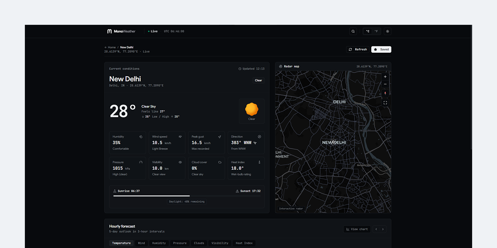

# MonoWeather

A clean, responsive weather dashboard built with React, TypeScript, and Vite. Displays real-time weather conditions, 5-day forecasts, air quality metrics, and interactive maps using data from OpenWeatherMap.

---

## Features

- **Current Weather & Telemetry**: Real-time temperature, "feels like", humidity, wind speed/direction, pressure, visibility, and sunrise/sunset times.
- **Hourly & 5-Day Forecast**: Interactive temperature and precipitation chart with wet-bulb calculations powered by Recharts.
- **Air Quality Index (AQI)**: 5-tier pollution monitoring with detailed pollutant breakdowns (PM₂.₅, PM₁₀, O₃, NO₂, SO₂, CO) and health recommendations.
- **Interactive Radar Map**: Embedded location map powered by MapLibre GL.
- **Location Search & Favorites**: City autocomplete search with history and quick-access pinned favorite cities saved to `localStorage`.
- **Geolocation Support**: Automatic local weather detection with fallback preset stations.
- **Customizable Preferences**: Celsius/Fahrenheit unit conversion and Dark/Light/System theme toggling.

---

## Tech Stack

| Layer              | Technologies                                                                                                         |
| ------------------ | -------------------------------------------------------------------------------------------------------------------- |
| **Framework**      | [React 18](https://react.dev/), [TypeScript](https://www.typescriptlang.org/), [Vite](https://vitejs.dev/)           |
| **Data Fetching**  | [TanStack React Query](https://tanstack.com/query)                                                                   |
| **Routing**        | [React Router v6](https://reactrouter.com/)                                                                          |
| **Styling & UI**   | [Tailwind CSS](https://tailwindcss.com/), [Radix UI](https://www.radix-ui.com/), [Lucide React](https://lucide.dev/) |
| **Visualizations** | [MapLibre GL](https://maplibre.org/), [Recharts](https://recharts.org/)                                              |
| **API Provider**   | [OpenWeatherMap API](https://openweathermap.org/api)                                                                 |

---

## Getting Started

### Prerequisites

- [Node.js](https://nodejs.org/) (v18.0.0 or higher recommended)
- [OpenWeatherMap API Key](https://openweathermap.org/api) (free tier)

### Installation

1. **Clone the repository:**
   ```bash
   git clone https://github.com/iamsayedanowar/KLIMATE.git
   cd KLIMATE
   ```

2. **Install dependencies:**
   ```bash
   npm install
   ```

3. **Configure environment variables:**
   Create a `.env` file in the root directory (or copy from `.env.example`):
   ```bash
   cp .env.example .env
   ```
   Add your OpenWeather API key:
   ```env
   VITE_OPENWEATHER_API_KEY=your_openweather_api_key_here
   ```

4. **Start the development server:**
   ```bash
   npm run dev
   ```

5. **Build for production:**
   ```bash
   npm run build
   ```

---

## Project Structure

```text
src/
├── api/            # OpenWeatherMap API client and TypeScript types
├── components/     # UI components (dashboard widgets, search, map, radar)
│   └── ui/         # Reusable primitives (buttons, dialogs, cards, popups)
├── context/        # Theme and temperature unit context providers
├── hooks/          # Custom hooks (geolocation, weather queries, localStorage)
├── lib/            # Utility functions
├── pages/          # Route pages (Dashboard, City View, Legal)
├── App.tsx         # App entrypoint, query provider, routing setup
└── main.tsx        # React root mount
```